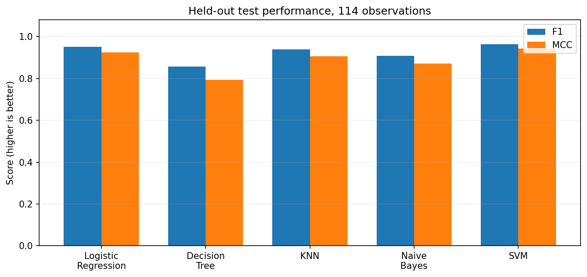

# WDBC Five-Model Evaluation Studio

**BITS Pilani WILP | M.Tech (AIML) | Machine Learning | Assignment 2**

> **Academic-use statement:** This is an explanatory reference implementation. The assessment instructions require each learner's original work, BITS Virtual Lab execution, and honest evidence. Adapt and justify the model choices, run the code on BITS Virtual Lab, and do not publish it as independently authored work without appropriate disclosure.

## a. Problem statement

Compare five classification algorithms on **one consistent dataset** and present their evaluation interactively. Predict whether a breast-mass cell-image feature record belongs to the malignant or benign category. The Streamlit interface loads saved models, validates an uploaded **labelled** test CSV, and calculates metrics, a confusion matrix, and a classification report. It **never fits models to the uploaded data**.

This is a teaching example, **not** a medical diagnostic tool.

## b. Dataset description

- **Original public source:** UCI Machine Learning Repository, *Breast Cancer Wisconsin (Diagnostic)*: https://archive.ics.uci.edu/dataset/17/breast-cancer-wisconsin-diagnostic
- **Data-loading mechanism:** `sklearn.datasets.load_breast_cancer`, a local distribution of the UCI dataset; no external download is needed for training.
- **Task:** supervised binary classification.
- **Size:** 569 observations, **30 numeric input features** (exceeds the 500-instance and 12-feature minimums).
- **Example feature groups:** mean, standard error, and worst values for radius, texture, perimeter, area, smoothness, compactness, concavity, concave points, symmetry, and fractal dimension.
- **Target:** `diagnosis`, where **1 = malignant (positive class)** and **0 = benign**. This project deliberately reverses scikit-learn's original encoding; the converted mapping is consistently used in training, test CSV, and reporting.
- **Missing data:** none in the packaged dataset.
- **Train/test split:** 80%/20%, stratified, random seed **42**: 455 training observations, 114 held-out test observations.
- **Avoiding leakage:** StandardScaler, where used, lives inside the fitted pipeline; training only uses the training partition. Test labels are not used during fitting or choosing hyperparameters.
- **Dataset limitations:** A small, historical benchmark; no evidence of clinical validity or real-world fairness can be inferred from these scores.

## c. GitHub Repository Link

**[INSERT YOUR OWN PUBLIC GITHUB REPOSITORY URL AFTER PUSHING AND VERIFYING IT]**

The repository must include `app.py`, `train_models.py`, `requirements.txt`, this `README.md`, `test_data.csv`, all five saved files in `model/`, and `model/metadata.json`. The result CSV and visualization are stored in `results/`.

## d. Models used and comparison table

All models use the **same** held-out test records. Logistic Regression, KNN and SVM use scaling inside training pipelines; Decision Tree and Gaussian Naive Bayes operate on the raw feature scales. The probability of class **1 (malignant)** is used for AUC.

| ML Model Name | Accuracy | AUC | Precision | Recall | F1 | MCC |
|:--|--:|--:|--:|--:|--:|--:|
| Logistic Regression | 0.9649 | **0.9960** | 0.9750 | **0.9286** | 0.9512 | 0.9245 |
| Decision Tree | 0.9035 | 0.9471 | 0.9429 | 0.7857 | 0.8571 | 0.7926 |
| K-Nearest Neighbors | 0.9561 | 0.9823 | 0.9744 | 0.9048 | 0.9383 | 0.9058 |
| Gaussian Naive Bayes | 0.9386 | 0.9934 | **1.0000** | 0.8333 | 0.9091 | 0.8715 |
| Support Vector Machine | **0.9737** | 0.9947 | **1.0000** | **0.9286** | **0.9630** | **0.9442** |

**Six required evaluation measures:** accuracy is overall correct classification; AUC summarises ranking quality over decision thresholds; precision is the proportion of positive predictions that are truly malignant; recall is the proportion of malignant samples detected; F1 is the harmonic mean of precision and recall; MCC measures binary prediction association considering all four confusion-matrix entries.

### Observations about model performance

| ML Model Name | Observation about model performance |
|:--|:--|
| Logistic Regression | Very strong ranking (highest AUC = 0.9960), high F1 (0.9512), with 3 false negatives and 1 false positive. Scaled linear decision boundary works well for these features. |
| Decision Tree | Lowest F1 (0.8571) and recall (0.7857), including 9 malignant observations labelled benign; a single shallow tree may underfit complex boundaries. |
| K-Nearest Neighbors | Competitive performance after feature scaling (F1 = 0.9383), but 4 false negatives and 1 false positive. Results may be sensitive to neighbour choice and feature scaling. |
| Gaussian Naive Bayes | Perfect positive precision on this held-out partition (no false positives), but recall is 0.8333 (7 false negatives). Its feature-independence assumption can be restrictive. |
| Support Vector Machine | Highest accuracy (0.9737), F1 (0.9630) and MCC (0.9442). There are 3 false negatives and no false positives; strong fit for this split. |
| **Overall winner on this dataset** | **RBF Support Vector Machine**, by the selected overall criteria of F1 and MCC, with top accuracy. Logistic Regression remains best in AUC. |

**Interpretation caution:** model rankings describe one reproducible hold-out split only; they are not an assurance of superiority on other data. Class imbalance and the high cost of missed malignant cases make recall, MCC, and confusion matrices important alongside accuracy.



## Reproduction and offline verification

Use Python 3.12 or 3.13 and the pinned version set in `requirements.txt`:

```bash
python -m pip install -r requirements.txt
python train_models.py
python verify_project.py
python -m streamlit run app.py
```

The training script regenerates the five `.joblib` models, `test_data.csv`, `model/metadata.json`, `results/model_comparison.csv`, and the chart. `verify_project.py` then reloads all model artifacts and checks that the saved benchmark numbers are reproducible.

**Important:** Execute these commands on **BITS Virtual Lab** and capture an **authentic screenshot showing the execution/environment**, per the assignment. This reference workspace is *not* BITS Virtual Lab.

## Streamlit interface and evaluation flow

1. Choose a model from the sidebar dropdown.
2. Use packaged sample test data, or upload a `.csv` containing all **30 input feature columns + `diagnosis`**.
3. The app validates the CSV, loads the selected classifier from `model/`, and displays accuracy, AUC, precision, recall, F1, and MCC.
4. Inspect confusion matrix, ROC curve, classification report, and a **side-by-side table of all five models' results on the uploaded test CSV**.
5. Download comparison metrics or predictions. AUC is marked N/A if only one ground-truth class is present.

No model is retrained while the app is running. Extra CSV columns are ignored; required feature names must match the sample test CSV exactly.

## Streamlit Community Cloud deployment

1. Commit and push the complete project contents to your personal GitHub repository (keep a genuine personal commit history).
2. Sign in at https://share.streamlit.io using GitHub.
3. Create a new application from that repository, choose the `main` branch, and set the entrypoint file to `app.py`.
4. Deploy and verify it loads, accepts `test_data.csv`, shows all metrics and the confusion matrix, and compares all models.
5. Put your **actual live URL** in both this README and the final submission PDF.

Official instructions: https://docs.streamlit.io/deploy/streamlit-community-cloud/deploy-your-app/deploy

**Live app URL: [INSERT URL AFTER A SUCCESSFUL DEPLOYMENT]**

## Directory map

```text
WDBC_Five_Model_Studio/
  app.py                         # Streamlit UI; evaluation only
  train_models.py                # train/serialize all five models
  verify_project.py              # load and recheck published test metrics
  requirements.txt               # deployment dependencies
  README.md                      # report narrative and instructions
  test_data.csv                  # actual labelled 114-record holdout
  .streamlit/config.toml         # distinctive app theme
  model/
    metadata.json
    logistic_regression.joblib
    decision_tree.joblib
    knn.joblib
    gaussian_nb.joblib
    svm_rbf.joblib
  results/
    model_comparison.csv
    performance_comparison.png
```

## Submission-specific evidence checklist

- [ ] Execute and review code on your **BITS Virtual Lab**.
- [ ] Take a real screenshot from that lab and embed it in **Section 3** of the final PDF.
- [ ] Make your own substantive modifications and explain your modeling decisions.
- [ ] Push all files to your own GitHub repository and test the public link.
- [ ] Deploy and manually test the genuine Streamlit Community Cloud link.
- [ ] Put both clickable URLs into the README and final PDF.
- [ ] Export **one PDF** with the required order: GitHub link, live app link, BITS screenshot, README contents.
- [ ] Submit the final PDF by **8 November 2026, 23:59**, and confirm submission (not draft).

**Plagiarism/integrity:** The assignment explicitly permits AI tools for learning support, but not directly copy-pasted submissions. Document and explain your original contributions honestly.
